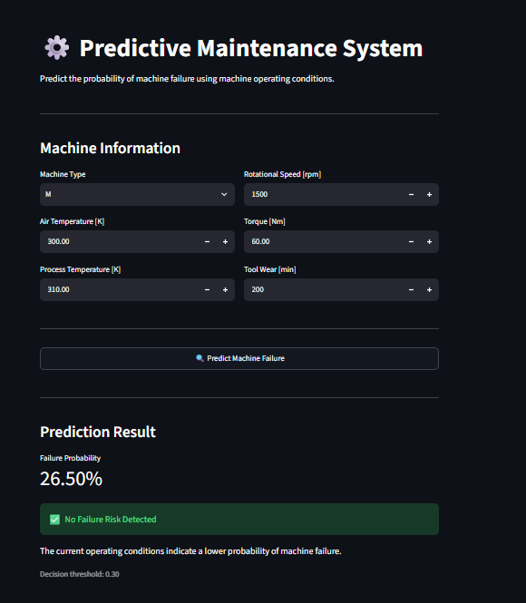
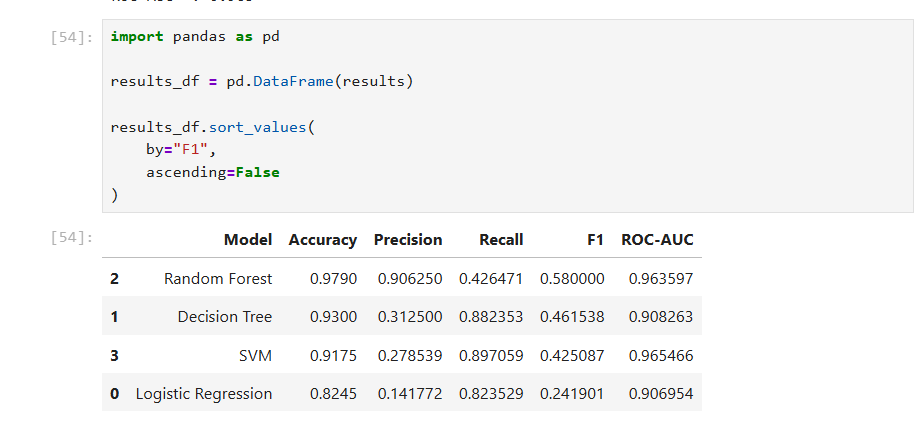
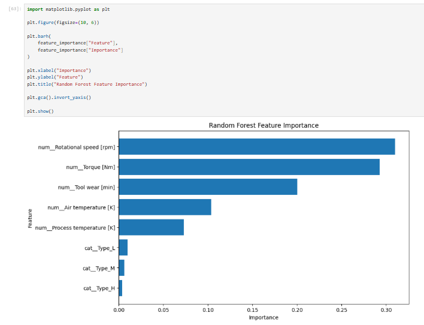

# Predictive Maintenance ML System

## Project Overview

This project develops a machine learning system that predicts the probability of machine failure using machine operating conditions and sensor-related data.

The goal is to identify machines that may be at higher risk of failure so that maintenance teams can take preventive action before unexpected downtime occurs.

The project includes:

* Exploratory Data Analysis
* Feature selection
* Data preprocessing
* Class imbalance handling
* Multiple machine learning models
* Model comparison
* Probability threshold tuning
* Model serialization
* Streamlit deployment

---

## Business Problem

Unexpected machine failures can cause:

* Production downtime
* Emergency maintenance
* Increased maintenance costs
* Production losses
* Delayed orders
* Operational risks

A traditional reactive maintenance process waits until a machine fails before taking action.

### Current Process

```text
Machine operates
       ↓
Problem occurs
       ↓
Machine fails
       ↓
Production stops
       ↓
Maintenance investigates
       ↓
Repair
       ↓
Production resumes
```

## Application Preview

### Streamlit Prediction Interface



### Model Comparison



### Feature Importance



### Proposed ML-Based Process

```text
Machine operates
       ↓
Sensor / operating data
       ↓
Machine Learning Model
       ↓
Failure probability
       ↓
Risk assessment
       ↓
Preventive maintenance
       ↓
Reduced unexpected downtime
```

---

## Business Objective

The primary objective is to identify machines at risk of failure early enough to support preventive maintenance decisions.

The system is designed to help:

* Reduce unexpected machine downtime
* Improve maintenance planning
* Reduce operational losses
* Support data-driven maintenance decisions

---

## ML Problem Formulation

This project is formulated as a **binary classification problem**.

### Target Variable

`Target`

| Value | Meaning            |
| ----: | ------------------ |
|     0 | No machine failure |
|     1 | Machine failure    |

The model predicts the probability that a machine belongs to the failure class.

---

## Dataset

The project uses the **AI4I 2020 Predictive Maintenance Dataset**.

Dataset size:

* 10,000 records
* 10 original columns
* Binary target variable
* No missing values
* No duplicate rows

### Important Features

| Feature                 | Description                        |
| ----------------------- | ---------------------------------- |
| Type                    | Machine quality/type: L, M, or H   |
| Air temperature [K]     | Air temperature around the machine |
| Process temperature [K] | Machine process temperature        |
| Rotational speed [rpm]  | Machine rotational speed           |
| Torque [Nm]             | Machine torque                     |
| Tool wear [min]         | Accumulated tool usage/wear        |
| Target                  | Machine failure indicator          |

### Target Distribution

The dataset is highly imbalanced:

* No Failure: 96.52%
* Failure: 3.48%

This imbalance makes accuracy alone an unreliable evaluation metric.

---

## Exploratory Data Analysis

### Distribution Analysis

The numerical features were analyzed using histograms and boxplots.

Key observations:

* Air temperature and process temperature have relatively narrow distributions.
* Rotational speed is right-skewed.
* Torque has a relatively bell-shaped distribution.
* Tool wear has a broader distribution.
* The failure class is highly underrepresented.

### Target-Based Analysis

The average values of several features differed between failure and non-failure machines.

| Feature                 | Target 0 Mean | Target 1 Mean |
| ----------------------- | ------------: | ------------: |
| Air Temperature [K]     |       299.974 |       300.886 |
| Process Temperature [K] |       309.996 |       310.290 |
| Rotational Speed [rpm]  |      1540.260 |      1496.487 |
| Torque [Nm]             |        39.630 |        50.168 |
| Tool Wear [min]         |       106.694 |       143.782 |

Torque and tool wear showed more noticeable differences between the two target classes.

However, differences in averages or correlations do not establish causation.

---

## Correlation Analysis

Important feature relationships included:

* Air Temperature ↔ Process Temperature: **0.876**
* Rotational Speed ↔ Torque: **-0.875**

Target correlations were relatively weak individually.

The strongest target correlation among the numerical features was:

* Torque: **0.191**
* Tool Wear: **0.105**
* Air Temperature: **0.083**
* Process Temperature: **0.036**
* Rotational Speed: **-0.044**

This indicates that machine failure is not determined by a single feature and that combinations of operating conditions are important.

---

## Feature Selection

The following features were used for model training:

```text
Type
Air temperature [K]
Process temperature [K]
Rotational speed [rpm]
Torque [Nm]
Tool wear [min]
```

### Excluded Features

#### UDI

Excluded because it is an identifier rather than a meaningful machine operating feature.

#### Product ID

Excluded because it is an identifier and does not represent machine operating behavior.

#### Failure Type

Excluded because it directly describes the failure outcome and could introduce target leakage into the binary failure prediction task.

---

## Data Preprocessing

The data was split into training and testing sets using an 80/20 split.

Stratified splitting was used to preserve the minority failure-class proportion.

### Numerical Features

Standardization was applied using:

```text
StandardScaler
```

### Categorical Feature

The `Type` feature was converted into numerical representation using:

```text
OneHotEncoder
```

Unknown categories are safely ignored during transformation.

The preprocessing steps were implemented using a `ColumnTransformer`.

---

## Handling Class Imbalance

Only 3.48% of the records represent machine failures.

Therefore, the models used:

```text
class_weight="balanced"
```

This gives greater importance to the minority failure class during training.

The test set was kept unchanged for evaluation.

---

## Models Evaluated

Four classification algorithms were compared:

1. Logistic Regression
2. Decision Tree
3. Random Forest
4. Support Vector Machine (SVM)

---

## Model Comparison

The models were evaluated using:

* Accuracy
* Precision
* Recall
* F1 Score
* ROC-AUC

| Model               | Accuracy | Precision | Recall |    F1 | ROC-AUC |
| ------------------- | -------: | --------: | -----: | ----: | ------: |
| Logistic Regression |    0.825 |     0.142 |  0.824 | 0.242 |   0.907 |
| Decision Tree       |    0.930 |     0.312 |  0.882 | 0.462 |   0.908 |
| Random Forest       |    0.979 |     0.906 |  0.426 | 0.580 |   0.964 |
| SVM                 |    0.917 |     0.279 |  0.897 | 0.425 |   0.965 |

### Model Selection

Random Forest provided the strongest overall balance at the default decision threshold.

It achieved:

* Accuracy: **97.9%**
* Precision: **90.6%**
* F1 Score: **0.580**
* ROC-AUC: **0.964**

SVM achieved slightly higher recall and ROC-AUC, but its precision was substantially lower.

Because false alarms can create unnecessary maintenance actions while missed failures can cause downtime, probability-based threshold tuning was performed for the Random Forest model.

---

## Threshold Tuning

The default classification threshold is:

```text
0.50
```

For this maintenance problem, the threshold can be adjusted according to the desired balance between detecting failures and generating false alarms.

Different thresholds were evaluated.

The best F1 score in the tested thresholds was obtained at:

```text
Threshold = 0.30
```

At this threshold:

* Precision: **0.767**
* Recall: **0.676**
* F1 Score: **0.719**

Therefore, the final application uses:

```text
Random Forest
+
Probability Threshold = 0.30
```

### Important Note

The threshold was selected during the project using the test results. In a production system, threshold selection should ideally be performed using a validation set or cross-validation, with the final test set kept untouched for unbiased evaluation.

---

## Final Model Pipeline

The final system combines preprocessing and the Random Forest model into a single pipeline.

```text
Raw Machine Data
       ↓
Categorical Encoding
       ↓
Numerical Scaling
       ↓
Random Forest
       ↓
Failure Probability
       ↓
Threshold = 0.30
       ↓
Failure / No Failure
```

The complete pipeline was serialized using `joblib`.

---

## Streamlit Application

A Streamlit application was developed to provide an interactive prediction interface.

Users can enter:

* Machine Type
* Air Temperature
* Process Temperature
* Rotational Speed
* Torque
* Tool Wear

The application returns:

* Failure Probability
* Failure/No Failure prediction
* Decision threshold
* Preventive maintenance recommendation when risk is detected

---

## Project Structure

```text
Predictive-Maintenance-ML/
│
├── data/
│   ├── raw/
│   │   └── predictive_maintenance.csv
│   └── processed/
│
├── notebooks/
│   └── predictive_maintenance_analysis.ipynb
│
├── models/
│   └── predictive_maintenance_model.pkl
│
├── app/
│   └── app.py
│
├── requirements.txt
├── .gitignore
└── README.md
```

---

## How to Run the Project

### 1. Clone the Repository

```bash
git clone <your-github-repository-url>
cd Predictive-Maintenance-ML
```

### 2. Install Dependencies

```bash
python -m pip install -r requirements.txt
```

### 3. Run the Streamlit Application

```bash
python -m streamlit run app/app.py
```

The application will open in the browser.

---

## Example Prediction

Example machine inputs:

```text
Machine Type: M
Air Temperature: 300 K
Process Temperature: 310 K
Rotational Speed: 1500 rpm
Torque: 60 Nm
Tool Wear: 200 min
```

Example model output:

```text
Failure Probability: 26.50%
Threshold: 0.30
Prediction: No Failure Risk
```

Since:

```text
26.50% < 30%
```

the system classifies the machine as:

```text
No Failure Risk Detected
```

---

## Technologies Used

* Python
* Pandas
* NumPy
* Scikit-learn
* Matplotlib
* Seaborn
* Joblib
* Streamlit
* Jupyter Notebook

---

## Future Improvements

Potential improvements for a production-grade system include:

* Threshold selection using a dedicated validation set
* Cost-sensitive evaluation based on actual maintenance costs
* Hyperparameter optimization
* Cross-validation
* Model explainability using SHAP
* Real-time sensor data integration
* Automated maintenance alerts
* Model monitoring and retraining
* Cloud deployment
* Database integration for historical machine records

---

## Key Learning Outcomes

Through this project, I worked on:

* Translating a business problem into an ML problem
* Exploratory data analysis
* Feature selection
* Data preprocessing
* Handling imbalanced classification
* Comparing multiple ML algorithms
* Evaluating classification models
* Probability threshold tuning
* Building an end-to-end ML pipeline
* Saving and loading trained models
* Deploying an ML model using Streamlit

---

## Conclusion

This project demonstrates an end-to-end predictive maintenance workflow, from understanding the business problem and analyzing machine data to training classification models and deploying the final prediction system through Streamlit.

The final solution uses a **Random Forest classifier with a 0.30 probability threshold** to identify machines that may require preventive maintenance.
